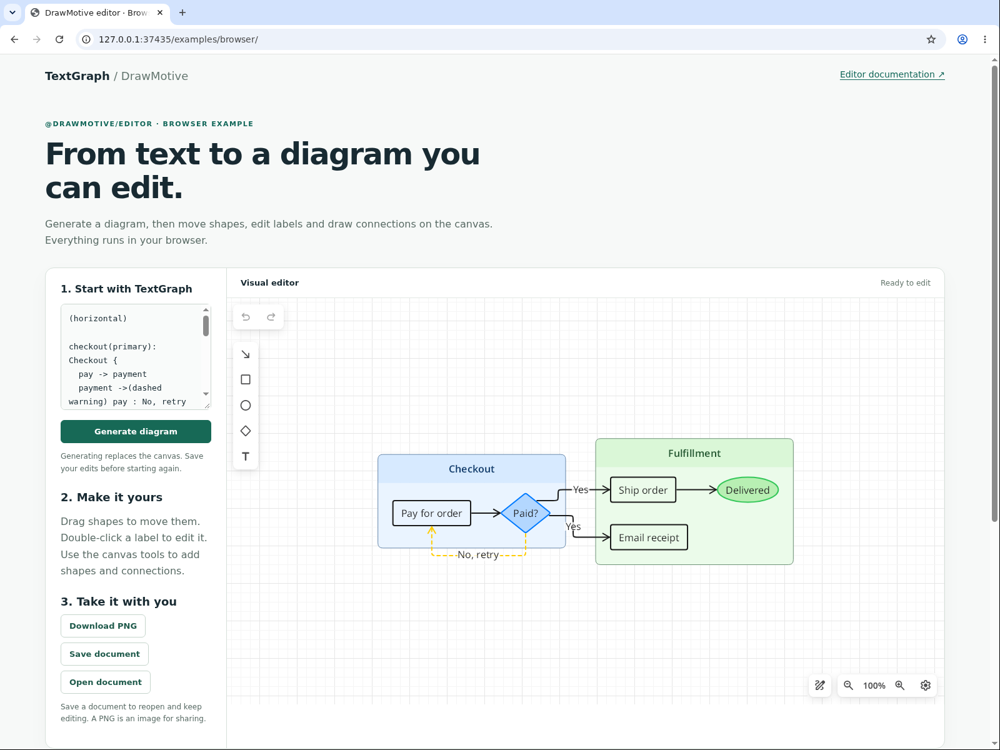

# @drawmotive/editor

Embed the DrawMotive visual editor and compose your own document, save and publish flows. Each instance owns an isolated browser runtime. The public SDK exposes editing operations and state; the host owns files, accounts and external persistence.

[SDK guide and API reference](docs/editor-sdk.md) · [Browser example](examples/browser/index.html) · [Website](https://textgraph.dev/editor/) · [Report an issue](https://github.com/drawmotive/drawmotive/issues)

**Single-canvas architecture:** one editor can be active per page. The canvas mounts directly into the host document; dispose it before opening another document.

## Example output

<!-- public-preview:start -->

```textgraph
(horizontal)

checkout(primary): Checkout {
  pay -> payment
  payment ->(dashed warning) pay : No, retry
}

fulfillment(success): Fulfillment {
  ship -> delivered
  email
}

payment -> ship : Yes
payment -> email : Yes

pay: Pay for order
payment(diamond fill primary): Paid?
ship: Ship order
email: Email receipt
delivered(ellipse fill success): Delivered
```


[Open the full diagram](examples/online-order.png) · [Copy the source](examples/online-order.textgraph) · [Try this diagram](https://textgraph.dev/playground?d=1.eJxNj71uwzAMhHc9xY0y0LyAhnToz1gEyNRRkOiaqCwJlNzAKfruheQ07kTiw_GOp6ckfE2x2jAo5SZyn2mpOgvPVtbB4OmG8K2AbFccjm3MFOsG2obDUXtbJvK4WIkcP4auNXhLDxCqsqofpcYljBxCu9BlcY5KGQxed9pDysS5pXgK_EVCXgE0Ww7NYg_cdAbvVP7Trrzhxg1OdsWYBEk8yZ9Ue7Zzih4tGnvdk2X_qJq1wbkFbFfd1eClmws54lzV_UFNIXAutJntzZ7vDX4BE_J6GA)

<!-- public-preview:end -->

For Chinese, Japanese, and color emoji, see the [packaged font examples](https://github.com/drawmotive/textgraph/tree/main/language-packs#language-coverage).

## Running in a browser



Serve the [browser example](examples/browser/index.html) over HTTP to generate the diagram and edit it visually.

To refresh documentation captures from the parent workspace, run
`npm run docs:capture -- editor`, then `npm run docs:previews -- sync` and
`npm run docs:previews -- check`. This uses the unchanged browser example,
headed Chromium, an isolated Xvfb display and a real display capture. Browser
tabs and address bar must be visible. The adjacent capture record contains
application/package versions, dimensions and source/pixel hashes.

## Install

```bash
npm install @drawmotive/editor
npx drawmotive-copy-assets public/editor
```

Copy the complete runtime after every upgrade. For Vite, run `drawmotive-copy-assets public/editor` in `predev` and `prebuild`. Serve runtime assets through HTTP(S), including `.wasm` as `application/wasm`; bundled applications must set `assetBaseUrl` explicitly.

## Standalone editor boundary

The public package provides editing UI, the canvas runtime and local browser services.
It requires editor assets served by a static host, without requiring a DrawMotive
business server, login session or collaboration connection for local editing.
It has no authentication or SignalR dependency and exposes no public synchronization API.
Internal applications own collaboration through separate private site packages and
private runtime integration; those packages and interfaces are not public editor exports.

Hosts use named functions such as `editor.setTool()` and `editor.setProperty()`;
there is no public `sendCommand`. Internally, these operations call the current
Blazor object directly through ordered Promise calls. One canvas is supported per
page, mounted in the host document. See [interop details](docs/editor-sdk.md#how-js-interoperates-with-the-engine), [configuration](docs/editor-sdk.md#ui-configuration) and [API reference](docs/editor-sdk.md#document-and-snapshot-api).

## Create and edit

The full entry requires `import "@drawmotive/editor/styles.css"` in a bundled host.
A native ESM page must link the package’s `dist/editor-ui.css`, as the browser example does.
All controls and popovers remain inside the editor container. Give that container a height.
Use `@drawmotive/editor/core` for a React-free instance with no UI chrome; inline text editing remains enabled.

```html
<div id="editor" style="height: 600px"></div>
```

```javascript
import { createEditor } from "@drawmotive/editor";
import "@drawmotive/editor/styles.css";

const editor = await createEditor({
  container: document.querySelector("#editor"),
  assetBaseUrl: "/editor/",
  ui: { buttons: { help: false } },
});
await editor.replaceTextGraph("User -> Application -> Database");
await editor.fitViewport();
const unsubscribe = editor.onStateChanged(state => console.log(state.revision));
const snapshot = await editor.exportSnapshot({ formats: ["raw", "png"] });
await persistDocument(snapshot.raw, snapshot.revision);
unsubscribe();
await editor.dispose();
```

Creation resolves after the configured empty scene and storage are ready. Replacement and fitting are separate operations. `raw` is an opaque base64 editable document, not TextGraph source. The default memory policy is temporary. Persistent mode requires an explicit namespace and documentId; all IndexedDB access runs in a Dedicated Worker, and disposal preserves that document.

TextGraph to canvas is intentionally a one-way workflow. Canvas edits belong to the saved document and do not rewrite TextGraph. Calling `replaceTextGraph()` again creates a replacement document; it does not merge source changes with earlier canvas edits.

## Operations

The `@drawmotive/editor/react` entry exports `Editor` (owns its canvas) and `EditorUi` (observes an existing core instance).
Import the same stylesheet, provide a sized parent, and memoize object options. Changing document identity disposes and recreates the instance.
The full imperative entry bundles React; the React entry uses the host’s React 19 installation.

```tsx
import { Editor } from "@drawmotive/editor/react";
import "@drawmotive/editor/styles.css";

const ui = { regions: { topRight: false }, drawingToolbar: { tools: ["rectangle", "arrow"] } };
export function Diagram() {
  return <Editor assetBaseUrl="/editor/" ui={ui} style={{ height: 600 }} />;
}
```

`ui.regions` independently configures each corner’s visibility, item order, `host.*` actions and `slot.*` React content.
`drawingToolbar` controls visibility, position and tools. `contextToolbar` filters object types, tools and panels.
`ui: false` disables chrome. `textEditing` independently selects `inline` (default), `external` or `disabled`.
Tooltip visibility, four-way position and delay are configured through `ui.tooltip`.

| Operation | Result or effect |
| --- | --- |
| `createEditor(options)` | Ready isolated instance |
| `replaceDocument(raw)` | Validates and replaces; resets selection/history |
| `replacePngDocument(base64)` | Validates a PNG with an embedded editable document, then replaces |
| `replaceTextGraph(source)` / `clearDocument()` | Establishes a new document |
| `exportSnapshot({ formats, render?, png? })` | Requested formats from one revision |
| `fitViewport({ padding?, minScale?, maxScale? })` | Display only; defaults: 60, 0.2, 1 |
| `setEditingEnabled(enabled)` | Controls user edits and JS history; loading/export remain available |
| `undo()` / `redo()` | Applies document history |
| `getState()` / `onStateChanged(listener)` | Current state / subscription with immediate replay |
| `setActionState(id, { label?, enabled?, visible? })` | Updates a declared host action |
| `dispose()` | Releases this instance and its writer lease; persistent documents remain |
| `copyToClipboard(token, { system? })` | Copies an opaque graph; reports system success separately from the internal copy |
| `pasteFromClipboard(position, { source? })` | Pastes through the engine; source is `auto`, `system` or `internal` |
| `onDisposed(listener)` | Releases host UI on disposal or forced page closure |

State contains `revision`, `health` (`healthy` or `faulted`), `editingEnabled`, `busy`, `canUndo` and `canRedo`. Revisions are opaque and instance-local. Document changes advance the revision; selection, zoom and pan do not. External save success confirms only its snapshot revision, so a delayed acknowledgment must not clear later edits. Undo may conservatively produce a new dirty revision even when content matches an earlier save.

Invalid imports preserve the document. An unfinished gesture or text edit reports `EditorBusy`; operations do not silently cancel input. A failed local transaction may report `faulted` with `revision: null`, blocking snapshots and further changes until an explicit successful replacement restores the instance. External save failures are host errors and do not fault the runtime.

## Snapshots and PNG documents

```javascript
const snapshot = await editor.exportSnapshot({
  formats: ["png"],
  render: { scale: 2, maxWidth: 1920, padding: 10 },
  png: { embedDocument: true },
});
await writeFile(snapshot.png.base64, snapshot.revision);
```

Choose distinct formats: `raw`, `png`, `svg`. Raw-only export does not render. Render defaults are `scale: 1` and `padding: 10`, with no product width limit. PNG contains `base64`, pixel `width/height`, `scale`, and logical `displayWidth/displayHeight`. SVG is a logical-coordinate string; `render.roundSvgNumbers` optionally rounds its numbers.

`png.embedDocument` defaults to false. When true, WASM inserts the editable document into the PNG from the same snapshot; hosts write the complete image without implementing chunks or CRC. PNG options require the PNG format. `replacePngDocument` rejects ordinary PNGs without embedded documents and damaged images without clearing the current diagram.

## Buttons and host actions

`ui.buttons` overrides built-in visibility. IDs are `undo`, `redo`, `arrow`, `rectangle`, `ellipse`, `diamond`, `text`, `sketchyMode`, `zoomIn`, `zoomOut`, `resetZoom`, `settings`, and `help`. All default visible except `help`. Visibility does not revoke editing permission or disable JS operations.

Declare product actions in order through `ui.actions`. IDs use the `host.` namespace, labels are text, and icons use existing icon names. Actions default visible and enabled; Save, Publish, accounts and product buttons are not built in.

```javascript
const editor = await createEditor({
  container, assetBaseUrl: runtimeUrl,
  ui: { actions: [{
    id: "host.save", label: "Save", icon: "save",
    async onInvoke({ editor, signal }) {
      const snapshot = await editor.exportSnapshot({ formats: ["png"], png: { embedDocument: true } });
      await saveAndConfirm(snapshot, signal);
    },
  }] },
});
```

Handlers stay in the host. Direct callbacks lets a handler export, update action state or dispose without holding the document queue. The runtime prevents repeated pending clicks and shows structured errors. Disposal/page exit cancels the handler signal without waiting for it; cancellation does not undo an external write. Unknown options, duplicate action IDs and missing handlers fail creation.

## Canvas lifecycle

One Blazor runtime and its browser fonts live for the page lifetime. Each document mounts a native canvas directly into the host container with a fresh document scope. Dispose the editor before creating its successor. A second active editor rejects with EditorAlreadyMounted. React UI and canvas share ordinary DOM events and focus.

Authentication, analytics and business requests belong to the host application. The core entry has no React dependency; the full entry bundles its React/Mantine UI, and the React entry shares the host React runtime.

Startup cancellation uses signal; startupTimeoutMs defaults to 120000. Document operations return direct Promises and run in order; storage/resource callbacks remain independent while C# awaits persistence or fonts. Runtime errors retain code and message. Disposal cancels host actions, waits for pending operations, removes the native root and releases Workers/storage. disposeTimeoutMs defaults to 5000. Unconfirmed cleanup rejects with DisposeCleanupUnconfirmed and blocks another editor until page reload. Page exit cleanup is best effort.

## Verification and release

Tooling requires Node.js 22+. Current Chromium is the verified visual-runtime target. CI declares Linux/Windows/macOS packaging; actual platform, mobile, Firefox/WebKit, VS Code and Forge checks must be reported separately. There is no Node/Worker visual editor.

```bash
npm ci
npm test
npm run build
npm run assets:verify
npm run audit:package
npx playwright install chromium
npm run test:browser
npm pack
```

Assets carry package version, exact committed producer and hashes. Native assets are rebuilt for each release; source, symbols, maps and embedded debug metadata are excluded. Package, native runtime and document format have separate version contracts.

## License

MIT. Bundled dependencies and fonts retain notices. See [NOTICE](NOTICE), [Contributing](CONTRIBUTING.md), [Changelog](CHANGELOG.md) and [Security reporting](SECURITY.md).
